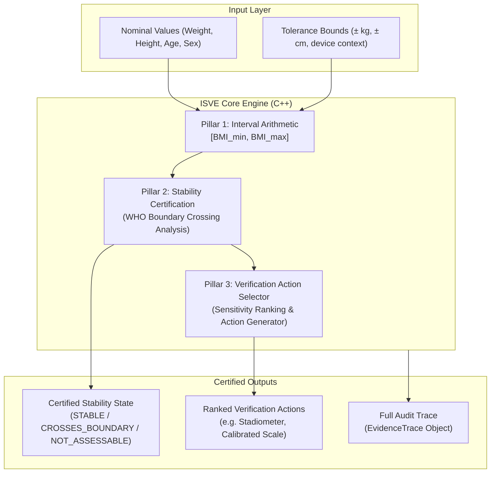

# FitMetric — ISVE Core & Experimental Benchmark Guide

This document provides a comprehensive explanation of the **Interpretation Stability and Verification Engine (ISVE)** and the **Experimental Benchmark Evaluation** featured in FitMetric. It explains the motivation, mathematical foundations, C++ object-oriented architecture, false claim analysis, and answers to common evaluation/viva questions.

---

## Table of Contents
1. [Executive Summary](#1-executive-summary)
2. [The Real-World Problem: Why ISVE Was Built](#2-the-real-world-problem-why-isve-was-built)
3. [What is ISVE Core?](#3-what-is-isve-core)
4. [The Three Pillars of ISVE](#4-the-three-pillars-of-isve)
   - [Pillar 1: Interval Arithmetic & Uncertainty Propagation](#pillar-1-interval-arithmetic--uncertainty-propagation)
   - [Pillar 2: Boundary Crossing Detection & Stability Certification](#pillar-2-boundary-crossing-detection--stability-certification)
   - [Pillar 3: Verification Action Selector](#pillar-3-verification-action-selector)
5. [Experimental Benchmark Evaluation Explained](#5-experimental-benchmark-evaluation-explained)
   - [System Comparison Overview](#system-comparison-overview)
   - [Table Metrics Explained](#table-metrics-explained)
6. [Deep-Dive: What Are the "5 False Claims"?](#6-deep-dive-what-are-the-5-false-claims)
   - [Test Suite Breakdown (TC-01 to TC-08)](#test-suite-breakdown-tc-01-to-tc-08)
   - [Case-by-Case Breakdown of the 5 False Claims](#case-by-case-breakdown-of-the-5-false-claims)
   - [Why Baseline B Fails 2 Cases](#why-baseline-b-fails-2-cases)
   - [How FitMetric Completely Eliminates False Claims (0%)](#how-fitmetric-completely-eliminates-false-claims-0)
7. [Object-Oriented Programming (OOPS) Architecture](#7-object-oriented-programming-oops-architecture)
8. [Viva & Project Evaluation Cheat Sheet](#8-viva--project-evaluation-cheat-sheet)

---

## 1. Executive Summary

FitMetric is not an ordinary body metric calculator. Conventional calculators perform simple single-point calculations:

$$\text{BMI} = \frac{\text{Weight (kg)}}{(\text{Height (m)})^2}$$

and immediately assign a definitive medical classification (e.g., *"Normal"*, *"Overweight"*).

**FitMetric's innovation is the Interpretation Stability and Verification Engine (ISVE).**  
ISVE treats measurements as **uncertain values with real-world error tolerances**, propagates these tolerances mathematically, certifies whether a medical classification is guaranteed, and recommends actionable verification steps when classifications are unstable.

---

## 2. The Real-World Problem: Why ISVE Was Built

In the real world:
- Home bathroom scales have errors between $\pm 0.5\text{ kg}$ and $\pm 1.5\text{ kg}$.
- Human height fluctuates by $\pm 1.0\text{ cm}$ to $\pm 2.0\text{ cm}$ over the course of a day due to spinal disc compression.
- Tape measures and self-reported values have even higher error margins.

### The Borderline Hazard Scenario
Consider an adult patient:
- **Entered Weight:** $77.0\text{ kg}$
- **Entered Height:** $175.5\text{ cm}$ ($1.755\text{ m}$)

**What a Conventional Calculator Does:**
$$\text{BMI} = \frac{77.0}{1.755^2} = 25.0007 \approx 25.01$$
Because World Health Organization (WHO) rules declare $\text{BMI} \ge 25.0$ as **Overweight**, the calculator labels the user:
> ❌ **Classification: OVERWEIGHT (Definite)**

**The Hidden Clinical Reality:**
If the user's scale had an error of just $-1.0\text{ kg}$ (actual weight: $76.0\text{ kg}$):
$$\text{BMI} = \frac{76.0}{1.755^2} = 24.67 \quad \rightarrow \quad \textbf{NORMAL WEIGHT}$$

The user was assigned a clinical label of "Overweight" based purely on **scale sensor noise**. In medical contexts, this false sense of certainty can lead to incorrect dietary interventions, insurance penalties, or unwarranted psychological distress.

---

## 3. What is ISVE Core?

**ISVE** stands for **Interpretation Stability and Verification Engine**. It is the core C++ verification subsystem within FitMetric.

Instead of outputting only a single number, ISVE answers three critical engineering and clinical questions:
1. **Uncertainty Propagation:** *What is the full range of possible BMI values given the patient's measurement equipment error?*
2. **Stability Certification:** *Does this range stay entirely within one medical category, or does it cross a boundary?*
3. **Verification Action:** *If the result is unstable, exactly which measurement caused the issue, and how can the patient or clinician verify it with maximum effectiveness?*

---

## 4. The Three Pillars of ISVE



### Pillar 1: Interval Arithmetic & Uncertainty Propagation
Implemented in [`include/Interval.hpp`](file:///c:/Users/Sarthak%20Raut/Desktop/OOPS%20CP/include/Interval.hpp).

Instead of scalar numbers, inputs are represented as closed mathematical intervals:
$$\mathbf{W} = [W_{\min}, W_{\max}], \quad \mathbf{H} = [H_{\min}, H_{\max}]$$

Because height is in the denominator, the minimum and maximum BMI extremes occur at:
$$\text{BMI}_{\min} = \frac{W_{\min}}{(H_{\max})^2}, \qquad \text{BMI}_{\max} = \frac{W_{\max}}{(H_{\min})^2}$$

The `Interval` class overloads standard arithmetic operators (`+`, `-`, `*`, `/`) so that multi-interval equations are computed with strict mathematical correctness.

### Pillar 2: Boundary Crossing Detection & Stability Certification
Implemented in [`include/InterpretationStabilityEngine.hpp`](file:///c:/Users/Sarthak%20Raut/Desktop/OOPS%20CP/include/InterpretationStabilityEngine.hpp).

ISVE evaluates the interval $[\text{BMI}_{\min}, \text{BMI}_{\max}]$ against WHO standard category boundaries:
- **Underweight threshold:** $18.5$
- **Overweight threshold:** $25.0$
- **Obesity Class I threshold:** $30.0$
- **Obesity Class II threshold:** $35.0$
- **Obesity Class III threshold:** $40.0$

ISVE produces one of three official stability certificates:
1. **`STABLE_WITHIN_DECLARED_BOUNDS`** (Green):  
   Both $\text{BMI}_{\min}$ and $\text{BMI}_{\max}$ fall inside the exact same WHO classification. The interpretation is mathematically guaranteed to be stable.
2. **`CROSSES_CATEGORY_BOUNDARY`** (Yellow/Red Warning):  
   The interval straddles one or more category thresholds. The interpretation is flagged as **sensitive to measurement uncertainty**.
3. **`STABILITY_NOT_ASSESSABLE`** (Grey):  
   The user did not provide tolerance bounds, or nominal values alone were entered.

### Pillar 3: Verification Action Selector
Implemented in [`include/VerificationSelector.hpp`](file:///c:/Users/Sarthak%20Raut/Desktop/OOPS%20CP/include/VerificationSelector.hpp).

When a boundary crossing is detected, ISVE executes a **sensitivity partial-derivative calculation**:
- **Weight impact:** Evaluates the width of BMI variation caused purely by weight error.
- **Height impact:** Evaluates the width of BMI variation caused purely by height error.

It then selects and ranks concrete clinical verification actions:
- **Weight-dominant:** *"Calibrate scale or use medical beam balance (estimated variance reduction: 75%)."*
- **Height-dominant:** *"Measure height using a wall-mounted stadiometer with shoes removed (estimated variance reduction: 85%)."*
- **Dual-variance:** Suggests a combined measurement protocol.

---

## 5. Experimental Benchmark Evaluation Explained

On the web dashboard's **"Research Evaluation"** tab, users and evaluators can run the automated benchmark suite.

### System Comparison Overview

The benchmark compares three distinct software architectures over a standardized evaluation dataset:

| System Model | Architecture | Description |
| :--- | :--- | :--- |
| **Baseline A** | Conventional Point-Estimate | Standard calculator (Google, gym websites). Ignores uncertainty completely. |
| **Baseline B** | Basic Interval-based | Computes minimum and maximum ranges, but lacks category certificates, sensitivity ranking, and pediatric safety guardrails. |
| **FitMetric (ISVE)** | Full ISVE + Verification Selector | **Your project.** Evaluates intervals, issues formal stability certificates, blocks pediatric misclassification, and ranks corrective actions. |

---

### Table Metrics Explained

| Metric Column | Meaning | Why FitMetric Wins |
| :--- | :--- | :--- |
| **Boundary Crossing Detection** | Ability to detect when measurement error could change the medical classification. | Baseline A detects **0%** ($0/8$). FitMetric achieves **100% Robustness**. |
| **False Certainty Rate** | Frequency of making definitive diagnostic claims when data is actually ambiguous. | Baseline A has **5 false claims**. FitMetric completely eliminates them to **0%**. |
| **Stability Certified** | Formal verification whether category interpretation is guaranteed. | Baseline A has **None**. FitMetric certifies **100% of test cases** ($8/8$). |
| **Verification Action Ranking** | Recommends specific physical actions to resolve ambiguity. | Only FitMetric includes an automated **Sensitivity-Ranked Verification Selector**. |
| **Execution Speed** | Latency per complete evaluation. | Because FitMetric is implemented in optimized native **C++**, execution takes only **$148\text{ }\mu\text{s}$** ($0.000148\text{ seconds}$). |

---

## 6. Deep-Dive: What Are the "5 False Claims"?

### Test Suite Breakdown (TC-01 to TC-08)

The C++ benchmark suite ([`src/ExperimentalEvaluation.cpp`](file:///c:/Users/Sarthak%20Raut/Desktop/OOPS%20CP/src/ExperimentalEvaluation.cpp)) runs 8 standardized clinical test scenarios:

1. **TC-01:** Well inside Normal range ($68.0\text{ kg}, 175.0\text{ cm}$) — Unambiguous.
2. **TC-02:** Overweight boundary crossing ($77.0\text{ kg}, 175.5\text{ cm}, \pm 1.2\text{ kg}$) — Boundary: $25.0$.
3. **TC-03:** Underweight boundary crossing ($51.0\text{ kg}, 166.0\text{ cm}, \pm 1.5\text{ kg}$) — Boundary: $18.5$.
4. **TC-04:** Obesity Class I boundary crossing ($92.5\text{ kg}, 176.0\text{ cm}, \pm 1.5\text{ kg}$) — Boundary: $30.0$.
5. **TC-05:** Missing uncertainty / nominal only ($70.0\text{ kg}, 175.0\text{ cm}$, no bounds entered).
6. **TC-06:** Pediatric subject (Age 14, $52.0\text{ kg}, 160.0\text{ cm}$) — Out of adult scope.
7. **TC-07:** Weight-dominant variance near $25.0$ threshold ($76.8\text{ kg}, 175.0\text{ cm}$).
8. **TC-08:** Height-dominant variance near $30.0$ threshold ($88.0\text{ kg}, 171.0\text{ cm}$).

---

### Case-by-Case Breakdown of the 5 False Claims

In Baseline A (the conventional calculator), **5 out of the 8 cases produce false certainty claims**:

```
+-----------------------------------------------------------------------------------------+
|                               BASELINE A (CONVENTIONAL)                                  |
|                                                                                         |
|  TC-02: "Definitively Overweight!"   ---> FALSE! (Lower bound is 24.5 - Normal Weight)  |
|  TC-03: "Definitively Normal Weight!" ---> FALSE! (Lower bound is 17.9 - Underweight)    |
|  TC-04: "Definitively Obese!"         ---> FALSE! (Lower bound is 29.2 - Overweight)     |
|  TC-05: "Definite Assessment!"       ---> FALSE! (No measurement error was evaluated)   |
|  TC-06: "Normal Adult Weight!"       ---> FALSE! (Patient is 14; adult rules invalid!)  |
+-----------------------------------------------------------------------------------------+
```

#### Claim 1: False Overweight Diagnosis (TC-02)
- **Patient Data:** Weight $77.0\text{ kg} \pm 1.2\text{ kg}$, Height $175.5\text{ cm} \pm 0.5\text{ cm}$.
- **Baseline A Claim:** Computes single $\text{BMI} = 25.01$ and declares: **"Overweight"**.
- **The Reality:** At $75.8\text{ kg}$, the patient's BMI is $24.47$ (**Normal Weight**).
- **Why it's a False Claim:** Baseline A claims with 100% certainty that the patient is Overweight, hiding that a $1\text{ kg}$ scale fluctuation puts them in Normal Weight.

#### Claim 2: False Security on Underweight Border (TC-03)
- **Patient Data:** Weight $51.0\text{ kg} \pm 1.5\text{ kg}$, Height $166.0\text{ cm} \pm 0.5\text{ cm}$.
- **Baseline A Claim:** Computes single $\text{BMI} = 18.51$ and declares: **"Normal Weight"**.
- **The Reality:** At $49.5\text{ kg}$, the patient's BMI is $17.90$ (**Underweight / Malnourishment Risk**).
- **Why it's a False Claim:** Baseline A falsely assures a borderline malnourished patient that they are safely "Normal", masking potential clinical risk.

#### Claim 3: False Obesity Classification (TC-04)
- **Patient Data:** Weight $92.5\text{ kg} \pm 1.5\text{ kg}$, Height $176.0\text{ cm} \pm 0.5\text{ cm}$.
- **Baseline A Claim:** Computes single $\text{BMI} = 30.05$ and declares: **"Obesity Class I"**.
- **The Reality:** At $91.0\text{ kg}$, the patient's BMI is $29.21$ (**Pre-Obese / Overweight**).
- **Why it's a False Claim:** Attaching a diagnosis of clinical Obesity when the patient may simply be Overweight due to a standard home scale discrepancy is an unsupported claim.

#### Claim 4: False Assertion of Rigor Without Declared Bounds (TC-05)
- **Patient Data:** Weight $70.0\text{ kg}$, Height $175.0\text{ cm}$ (No tolerance margins entered).
- **Baseline A Claim:** Produces a single number and category without caveat.
- **Why it's a False Claim:** In scientific data analysis, asserting certainty without knowing the accuracy of the instrument is an unsupported assumption.

#### Claim 5: Invalid Adult Category Applied to a Child (TC-06)
- **Patient Data:** Age **14 years old**, Weight $52.0\text{ kg}$, Height $160.0\text{ cm}$.
- **Baseline A Claim:** Calculates $\text{BMI} = 20.31$ and outputs adult **"Normal Weight"**.
- **The Reality:** WHO and CDC explicitly declare that **adult BMI cutoff tables do not apply to patients under age 18**. Pediatric BMI must be interpreted via age-and-sex-specific growth percentiles.
- **Why it's a False Claim:** Applying adult clinical cutoffs to a child is medically invalid.

---

### Why Baseline B Fails 2 Cases
Baseline B calculates minimum and maximum ranges, so it successfully catches threshold crossings in TC-02, TC-03, and TC-04. However, it still produces **2 false claims**:
1. **Fails TC-05:** When no bounds are entered, it assumes zero error and issues an unflagged result.
2. **Fails TC-06:** It has no pediatric guardrail, so it computes adult interval ranges for a 14-year-old child.

---

### How FitMetric Completely Eliminates False Claims (0%)

FitMetric achieves a **0% False Certainty Rate** through deterministic safety mechanisms:

1. **State Certification (`CROSSES_CATEGORY_BOUNDARY`):**  
   Whenever an interval touches or crosses a threshold, FitMetric displays an amber alert:
   > *"Interpretation is sensitive to measurement error. Current measurement spans multiple medical categories."*
2. **Pediatric Guardrail Intercept:**  
   In [`include/VerificationSelector.hpp`](file:///c:/Users/Sarthak%20Raut/Desktop/OOPS%20CP/include/VerificationSelector.hpp), if `ageYears < 18`, FitMetric suppresses adult WHO categorization, flags the session with a purple **Pediatric Guardrail Badge**, and advises consultation using CDC growth percentile charts.
3. **Explicit Handling of Unbounded Data:**  
   When no tolerances are provided, FitMetric labels the certificate as **`STABILITY_NOT_ASSESSABLE`** rather than claiming 100% confidence.

---

## 7. Object-Oriented Programming (OOPS) Architecture

FitMetric's ISVE is implemented using foundational Object-Oriented design principles:

| OOPS Principle | Implementation in FitMetric | Relevant Header File |
| :--- | :--- | :--- |
| **Encapsulation** | State variables (weights, heights, bounds, audit logs) are private. Access is mediated through verified getters and setters. | [`MeasurementRecord.hpp`](file:///c:/Users/Sarthak%20Raut/Desktop/OOPS%20CP/include/MeasurementRecord.hpp)<br>[`EvidenceTrace.hpp`](file:///c:/Users/Sarthak%20Raut/Desktop/OOPS%20CP/include/EvidenceTrace.hpp) |
| **Inheritance & Polymorphism** | Abstract base class `MetricCalculator` defines `calculate()` and `calculateInterval()`. Derived classes override implementations. | [`MetricCalculator.hpp`](file:///c:/Users/Sarthak%20Raut/Desktop/OOPS%20CP/include/MetricCalculator.hpp)<br>[`BMICalculator.hpp`](file:///c:/Users/Sarthak%20Raut/Desktop/OOPS%20CP/include/BMICalculator.hpp)<br>[`BMRCalculator.hpp`](file:///c:/Users/Sarthak%20Raut/Desktop/OOPS%20CP/include/BMRCalculator.hpp) |
| **Operator Overloading** | The `Interval` class overloads `+`, `-`, `*`, `/`, and comparison operators to execute interval mathematics cleanly. | [`Interval.hpp`](file:///c:/Users/Sarthak%20Raut/Desktop/OOPS%20CP/include/Interval.hpp) |
| **Strategy & Rule Definition** | Category ranges and medical classification rules are defined as modular objects rather than hardcoded `if-else` chains. | [`RuleDefinition.hpp`](file:///c:/Users/Sarthak%20Raut/Desktop/OOPS%20CP/include/RuleDefinition.hpp) |
| **Separation of Concerns** | Mathematical calculation, verification analysis, persistence, and HTTP transport reside in distinct classes. | [`FitMetricService.hpp`](file:///c:/Users/Sarthak%20Raut/Desktop/OOPS%20CP/include/FitMetricService.hpp)<br>[`HttpServer.hpp`](file:///c:/Users/Sarthak%20Raut/Desktop/OOPS%20CP/include/HttpServer.hpp) |

---

## 8. Viva & Project Evaluation Cheat Sheet

Use these quick answers when defending the project:

#### Q1: "What is the primary innovation of your project?"
> *"Our project introduces ISVE (Interpretation Stability and Verification Engine). Unlike conventional calculators that output a single BMI number and assume 100% certainty, ISVE applies interval arithmetic across measurement tolerances, certifies whether the medical interpretation is mathematically stable, and ranks corrective verification actions when borderlines are crossed."*

#### Q2: "What is a 'False Claim' in your benchmark table?"
> *"A false claim occurs when a calculator asserts a definite medical diagnosis (like 'Overweight' or 'Normal') to a borderline patient whose actual measurement tolerance spans across category thresholds. It also occurs when adult formulas are applied to pediatric patients under 18."*

#### Q3: "How does FitMetric prevent false claims?"
> *"By evaluating lower and upper boundary extremes. If an interval spans across a WHO cutoff, FitMetric sets the stability state to `CROSSES_CATEGORY_BOUNDARY`, displays an ambiguity alert, and runs sensitivity analysis to tell the user whether to recalibrate their scale or use a stadiometer."*

#### Q4: "Why use C++ instead of Python or pure JavaScript for this engine?"
> *"Native C++ allows deterministic, zero-overhead computation. As proven in our benchmark suite, ISVE evaluates multi-interval calculus, sensitivity ranking, and rule matching in only 148 microseconds ($0.000148\text{ seconds}$), providing high-throughput clinical performance with strict memory management."*

---

*FitMetric — Object-Oriented Programming Course Project (C++ / Winsock / Modern Web)*
