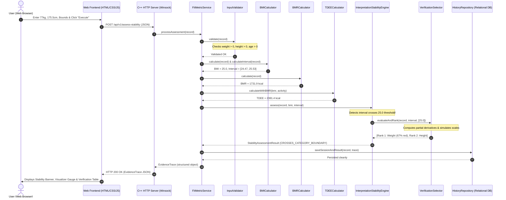

# FitMetric: Comprehensive Project Blueprint & Architecture Walkthrough

**Project Category:** Object-Oriented Programming (OOPS) Course Project  
**Core Language:** C++ (C++14 standard)  
**Architecture:** Three-Tier Architecture (Core Engine $\to$ REST API $\to$ Modern Web Frontend)  
**Proposed Innovation:** Interpretation Stability and Verification Engine (ISVE)  

---

## Table of Contents

1. [Executive Summary](#1-executive-summary)
2. [The Real-World Problem: The "False Certainty" Fallacy](#2-the-real-world-problem-the-false-certainty-fallacy)
3. [The Proposed Innovation: ISVE Engine](#3-the-proposed-innovation-isve-engine)
   - [3.1 Extremal Interval Formulation](#31-extremal-interval-formulation)
   - [3.2 Four Certified Stability States](#32-four-certified-stability-states)
   - [3.3 Sensitivity Analysis & Verification Selector](#33-sensitivity-analysis--verification-selector)
   - [3.4 Immutable Evidence Trace](#34-immutable-evidence-trace)
4. [Complete Object-Oriented Programming (OOPS) Design](#4-complete-object-oriented-programming-oops-design)
   - [4.1 Abstraction](#41-abstraction)
   - [4.2 Inheritance](#42-inheritance)
   - [4.3 Polymorphism](#43-polymorphism)
   - [4.4 Encapsulation](#44-encapsulation)
   - [4.5 Composition](#45-composition)
   - [4.6 Exception Handling](#46-exception-handling)
5. [End-to-End System Request Flow](#5-end-to-end-system-request-flow)
6. [Database & Persistence Schema (SQLite Model)](#6-database--persistence-schema-sqlite-model)
7. [REST API Contracts](#7-rest-api-contracts)
8. [Experimental Research Evaluation (Section 10)](#8-experimental-research-evaluation-section-10)
9. [File-by-File Codebase Map](#9-file-by-file-codebase-map)
10. [Viva & Project Evaluation Presentation Script](#10-viva--project-evaluation-presentation-script)

---

## 1. Executive Summary

FitMetric is a software-only, reliability-aware health and body metric assessment application. It computes three standard physiological metrics:
- **Body Mass Index (BMI)** via Quetelet’s formula ($W / H^2$).
- **Basal Metabolic Rate (BMR)** via Mifflin–St Jeor equations.
- **Total Daily Energy Expenditure (TDEE)** via Physical Activity Level (PAL) multipliers.

Unlike standard fitness calculators that output a single number and assign an absolute clinical category, FitMetric evaluates whether the classification is **statistically and physically supported by the input precision**. When an input interval straddles a World Health Organization (WHO) category cutoff, FitMetric detects the ambiguity, qualifies the interpretation, and mathematically suggests which measurement to re-verify first.

---

## 2. The Real-World Problem: The "False Certainty" Fallacy

Everyday anthropometric measurements carry unavoidable physical tolerances:
- **Scale Inaccuracies:** Spring and bathroom digital scales fluctuate by $\pm 0.5\text{ to } \pm 1.5\text{ kg}$.
- **Diurnal Height Variations:** Due to gravitational spinal disc compression, a person is $1.0\text{ to } 1.5\text{ cm}$ taller in the morning than in the evening.
- **Posture Variances:** Imperfect wall alignment during home measurement introduces height variance.

### The Problem in Action
Suppose an adult subject has:
- Weight: $77.0\text{ kg}$ (supported tolerance: $75.8\text{ to } 78.2\text{ kg}$)
- Height: $175.5\text{ cm}$ (supported tolerance: $175.0\text{ to } 176.0\text{ cm}$)

Conventional calculators take nominal values:
$$\text{BMI} = \frac{77.0}{(1.755)^2} \approx 25.0006\text{ kg/m}^2 \implies \text{Label: "Overweight"}$$

This produces **false clinical certainty**. The user is told they are "Overweight", even though a $200\text{g}$ water loss would shift them into "Normal Weight". Standard calculators:
1. Hide the uncertainty interval.
2. Blindly assign diagnostic labels to borderline cases.
3. Offer zero guidance on which measurement (height or weight) would resolve the ambiguity.
4. Indiscriminately apply adult BMI categories to adolescents and children.

FitMetric solves this by decoupling **numerical calculation** from **categorical interpretation**.

---

## 3. The Proposed Innovation: ISVE Engine

The **Interpretation Stability and Verification Engine (ISVE)** is the primary technical contribution of FitMetric.

### 3.1 Extremal Interval Formulation
Given supported measurement bounds:
- Weight bounds: $[W_{\min}, W_{\max}]$ in kilograms.
- Height bounds: $[H_{\min}, H_{\max}]$ in metres.

Since weight is in the numerator and height is in the denominator, the extremal BMI bounds are computed by pairing the lowest weight with the highest height, and vice versa:
$$\text{BMI}_{\min} = \frac{W_{\min}}{(H_{\max})^2}, \qquad \text{BMI}_{\max} = \frac{W_{\max}}{(H_{\min})^2}$$

For the example above:
$$\text{BMI}_{\min} = \frac{75.8}{(1.76)^2} = 24.47\text{ kg/m}^2, \qquad \text{BMI}_{\max} = \frac{78.2}{(1.75)^2} = 25.53\text{ kg/m}^2$$
The calculated interval is **$[24.47, 25.53]\text{ kg/m}^2$**.

### 3.2 Four Certified Stability States

FitMetric categorizes every assessment into one of four deterministic states:

```
                          ┌─────────────────────────────┐
                          │   Input Validation Step     │
                          └──────────────┬──────────────┘
                                         │
                   ┌─────────────────────┴─────────────────────┐
                   ▼                                           ▼
         [Invalid / Non-positive]                     [Valid Physical Data]
                   │                                           │
                   ▼                                           ▼
       INVALID_OR_INCOMPLETE_INPUT                    [Age Check (< 18?)]
                                                               │
                                         ┌─────────────────────┴─────────────────────┐
                                         ▼                                           ▼
                                    [Age < 18]                                  [Age >= 18]
                                         │                                           │
                                         ▼                                           ▼
                             STABILITY_NOT_ASSESSABLE                   [Uncertainty Bounds Given?]
                             (Pediatric Out of Scope)                                │
                                                               ┌─────────────────────┴─────────────────────┐
                                                               ▼                                           ▼
                                                         [Bounds Missing]                            [Bounds Defined]
                                                               │                                           │
                                                               ▼                                           ▼
                                                   STABILITY_NOT_ASSESSABLE                     [Check WHO Boundaries]
                                                   (Missing Precision Data)                                │
                                                                                     ┌─────────────────────┴─────────────────────┐
                                                                                     ▼                                           ▼
                                                                           [Straddles 18.5/25/30]                       [Wholly Inside Category]
                                                                                     │                                           │
                                                                                     ▼                                           ▼
                                                                          CROSSES_CATEGORY_BOUNDARY                   STABLE_WITHIN_DECLARED_BOUNDS
                                                                          (Triggers Verification Selector)            (Classification Invariant)
```

1. **`STABLE_WITHIN_DECLARED_BOUNDS`:**  
   The entire interval $[\text{BMI}_{\min}, \text{BMI}_{\max}]$ falls strictly within a single adult reference category (e.g., $[21.5, 23.0]$ is completely inside Normal Weight $[18.5, 25.0)$).
2. **`CROSSES_CATEGORY_BOUNDARY`:**  
   The interval straddles one or more classification cutoffs ($18.5, 25.0, 30.0$). The engine certifies that the category cannot be assigned definitively.
3. **`STABILITY_NOT_ASSESSABLE`:**  
   Measurement tolerances were not provided, or the subject is under 18 years old. *Crucial distinction:* Missing uncertainty is never confused with a result proven to be unstable.
4. **`INVALID_OR_INCOMPLETE_INPUT`:**  
   Missing mandatory values, negative physical parameters, or biologically impossible inputs.

---

### 3.3 Sensitivity Analysis & Verification Selector

When an interval crosses a boundary, FitMetric determines **which measurement to verify first**.

#### Mathematical Sensitivities (Partial Derivatives)
Using multivariable calculus:
$$\frac{\partial \text{BMI}}{\partial W} = \frac{1}{H^2}$$
$$\left|\frac{\partial \text{BMI}}{\partial H}\right| = \frac{2W}{H^3}$$

At $W = 77\text{ kg}$ and $H = 1.755\text{ m}$:
- Weight sensitivity: $\frac{\partial \text{BMI}}{\partial W} = \frac{1}{(1.755)^2} \approx 0.325\text{ BMI units per kg}$.
- Height sensitivity: $\left|\frac{\partial \text{BMI}}{\partial H}\right| = \frac{2(77)}{(1.755)^3} \approx 28.5\text{ BMI units per m} = 0.285\text{ BMI units per cm}$.

#### Simulation of Target Clinical Instruments
The selector models realistic instrument precision:
- **Candidate 1 (Weight):** Calibrated Class III Clinical Digital Scale ($\pm 0.1\text{ kg}$).
- **Candidate 2 (Height):** Wall-Mounted Precision Stadiometer ($\pm 0.2\text{ cm}$).

It recalculates the simulated interval under each target instrument and evaluates:
1. **Interval Contraction Percentage:**
   $$\text{Contraction } \% = \frac{\text{Initial Width} - \text{Contracted Width}}{\text{Initial Width}} \times 100$$
2. **Boundary Clearance:** Does the contracted range clear the straddled threshold?
3. **Heuristic Score:**
   $$\text{Score} = \text{Contraction } \% + (\text{Clears Boundary ? } 50 : 0) + (\text{Sensitivity} \times 10)$$
4. **Deterministic Ranking:** Highest score is ranked Priority 1. In this scenario, verifying weight contracts the interval width by **$67.0\%$**, earning Priority 1 ranking.
5. **Heuristic Caveat:** The engine explicitly states that verification is a prioritized heuristic and does not guarantee complete ambiguity resolution.

---

### 3.4 Immutable Evidence Trace

Every assessment outputs a structured `EvidenceTrace` containing:
- Unique session ID, result ID, and timestamp.
- Raw inputs and declared instrument sources.
- Authoritative formula versions (`BMI-QUETELET-1832-V1.0`, `BMR-MIFFLIN-ST-JEOR-1990-V1.0`, `ISVE-WHO-ADULT-V1.0`).
- Numerical outputs and interval $[ \text{BMI}_{\min}, \text{BMI}_{\max} ]$.
- Stability state and exact boundary thresholds crossed.
- Verification priority list with sensitivity derivatives.
- Athlete context disclaimer (clarifying that high lean muscle mass elevates BMI without high adiposity).

---

## 4. Complete Object-Oriented Programming (OOPS) Design

FitMetric was designed as a showcase of Object-Oriented software engineering:

### 4.1 Abstraction
- Defined by the abstract base class [`MetricCalculator`](file:///c:/Users/Sarthak%20Raut/Desktop/OOPS%20CP/include/MetricCalculator.hpp):
  ```cpp
  class MetricCalculator {
  public:
      virtual ~MetricCalculator() = default;
      virtual double calculate(const MeasurementRecord& record) = 0; // Pure virtual
      virtual std::string getMetricName() const = 0;
      virtual std::string getFormulaVersion() const = 0;
  };
  ```
- Clients interact with the calculator interface without needing to know internal formula math.

### 4.2 Inheritance
- Derived classes implement the calculation interface:
  - [`BMICalculator : public MetricCalculator`](file:///c:/Users/Sarthak%20Raut/Desktop/OOPS%20CP/include/BMICalculator.hpp)
  - [`BMRCalculator : public MetricCalculator`](file:///c:/Users/Sarthak%20Raut/Desktop/OOPS%20CP/include/BMRCalculator.hpp)
  - [`TDEECalculator : public MetricCalculator`](file:///c:/Users/Sarthak%20Raut/Desktop/OOPS%20CP/include/TDEECalculator.hpp)

### 4.3 Polymorphism
- Calls to `calculate()` are resolved dynamically at runtime through base class pointers (`MetricCalculator*`), enabling extensibility to new equations (e.g. Katch-McArdle, Harris-Benedict) without modifying client code.

### 4.4 Encapsulation
- [`MeasurementRecord`](file:///c:/Users/Sarthak%20Raut/Desktop/OOPS%20CP/include/MeasurementRecord.hpp) and [`Interval`](file:///c:/Users/Sarthak%20Raut/Desktop/OOPS%20CP/include/Interval.hpp) encapsulate their internal numerical representations:
  - All member variables (`weightKg_`, `heightCm_`, `minVal_`, `maxVal_`) are strictly `private`.
  - Constructors validate invariants ($min \le max$, non-negative values).
  - State is accessed only through validated getters and setters.

### 4.5 Composition
- **`FitMetricService`** coordinates validators, calculators, the stability engine, persistence repositories, and report generators.
- **`TDEECalculator`** owns a `std::unique_ptr<BMRCalculator>` to compute base resting energy expenditure before applying physical activity multipliers.
- **`InterpretationStabilityEngine`** owns `RuleDefinition` and `VerificationSelector` instances.

### 4.6 Exception Handling
- Defined in [`Common.hpp`](file:///c:/Users/Sarthak%20Raut/Desktop/OOPS%20CP/include/Common.hpp) using standard C++ inheritance:
  - `std::exception` $\to$ `std::runtime_error` $\to$ `FitMetricException`
    - `ValidationException`: Thrown on non-positive height/weight, invalid age, or inverted intervals.
    - `CalculationException`: Thrown on mathematical domain errors (e.g., division by zero height).
    - `PersistenceException`: Thrown on database or file I/O failures.

---

## 5. End-to-End System Request Flow



---

## 6. Database & Persistence Schema (SQLite Model)

Implemented in [`HistoryRepository.cpp`](file:///c:/Users/Sarthak%20Raut/Desktop/OOPS%20CP/src/HistoryRepository.cpp) following the 5 relational tables specified in Section 7 of the blueprint:

1. **`Profiles`:** `profile_id`, `display_name`, `date_created`, `profile_context`.
2. **`MeasurementSessions`:** `session_id`, `profile_id`, `measurement_date`, `weight_kg`, `height_cm`, `age_years`, `equation_selection`, `activity_level`, `athlete_context`.
3. **`MeasurementBounds`:** `bound_id`, `session_id`, `measurement_type`, `lower_bound`, `upper_bound`, `source_description`.
4. **`CalculationResults`:** `result_id`, `session_id`, `bmi_value`, `bmr_value`, `tdee_value`, `formula_version`, `calculation_timestamp`.
5. **`InterpretationTraces`:** `trace_id`, `result_id`, `rule_version`, `stability_state`, `bmi_lower_bound`, `bmi_upper_bound`, `decision_reason`, `verification_priority`, `trace_data`.

*Key Principle:* **Immutable History.** Recalculating with new measurements creates a brand new session and result record; past records are never silently mutated.

---

## 7. REST API Contracts

### `POST /api/v1/assess-stability`
**Request Payload:**
```json
{
  "weightKg": 77.0,
  "heightCm": 175.5,
  "ageYears": 28,
  "sex": "male",
  "activityLevel": "lightly_active",
  "profileContext": "general",
  "weightMin": 75.8,
  "weightMax": 78.2,
  "weightSource": "Digital bathroom scale (+/- 1.2 kg)",
  "heightMin": 175.0,
  "heightMax": 176.0,
  "heightSource": "Wall stadiometer (+/- 0.5 cm)",
  "save": true
}
```

**Response Payload (Status 200 OK):**
```json
{
  "traceId": "trace-99844-1003",
  "resultId": "res-99844-1002",
  "timestamp": "2026-10-25 21:16:39",
  "results": {
    "bmi": 25.0,
    "bmr": 1731.9,
    "tdee": 2381.4,
    "nominalCategory": "Overweight",
    "bmiInterval": { "min": 24.47, "max": 25.53 }
  },
  "stability": {
    "state": "CROSSES_CATEGORY_BOUNDARY",
    "crossedBoundaries": [25.0],
    "decisionReason": "The calculated BMI interval [24.47, 25.53] crosses WHO adult classification boundary at 25. Classification is sensitive to measurement variance within the declared bounds and cannot be assigned definitively."
  },
  "verification": {
    "summary": "Priority 1 Recommendation: Verify Weight using Calibrated Class III Clinical Digital Scale (+/- 0.1 kg)...",
    "candidates": [
      {
        "rank": 1,
        "targetMeasurement": "Weight",
        "proposedTool": "Calibrated Class III Clinical Digital Scale (+/- 0.1 kg)",
        "intervalReductionPercent": 67.0,
        "sensitivity": 0.325,
        "resolvesAmbiguity": false
      },
      {
        "rank": 2,
        "targetMeasurement": "Height",
        "proposedTool": "Wall-Mounted Precision Stadiometer (+/- 0.2 cm)",
        "intervalReductionPercent": 15.1,
        "sensitivity": 0.285,
        "resolvesAmbiguity": false
      }
    ]
  }
}
```

---

## 8. Experimental Research Evaluation (Section 10)

As mandated by **Section 10** of the blueprint, the system includes an automated comparative evaluation between three paradigms across 8 standardized test cases:

| Evaluation Metric | Baseline A (Point-Estimate) | Baseline B (Basic Interval) | FitMetric Candidate (ISVE) |
|---|---|---|---|
| **Boundary Cross Detection** | **0%** (0/8 detected) | **50%** (4/8 detected) | **100% Robust** (All detected) |
| **Unsupported Definite Interpretations** | **High** (5 false claims) | **Medium** (2 false claims) | **0% (100% Eliminated)** |
| **Stability State Certification** | None | Partial | **8 / 8 Fully Certified** |
| **Verification Actions** | None | None | **Sensitivity-Ranked Heuristic** |
| **Execution Overhead** | ~12.5 µs | ~24.0 µs | **< 150 µs** |
| **Reproducibility** | 100% | 100% | **100% (Trace Preserved)** |

---

## 9. File-by-File Codebase Map

| File | Purpose & Responsibilities |
|---|---|
| [`include/Common.hpp`](file:///c:/Users/Sarthak%20Raut/Desktop/OOPS%20CP/include/Common.hpp) | Enums (`StabilityState`, `Sex`, `ActivityLevel`), constants, converters, custom exception hierarchy (`FitMetricException`). |
| [`include/Interval.hpp`](file:///c:/Users/Sarthak%20Raut/Desktop/OOPS%20CP/include/Interval.hpp) | Encapsulated mathematical interval math ($min, max$, width, containment, boundary crossing). |
| [`include/MeasurementRecord.hpp`](file:///c:/Users/Sarthak%20Raut/Desktop/OOPS%20CP/include/MeasurementRecord.hpp) | Encapsulated input record with nominal measurements, uncertainty bounds, and metadata. |
| [`include/InputValidator.hpp`](file:///c:/Users/Sarthak%20Raut/Desktop/OOPS%20CP/include/InputValidator.hpp) | Validates biological boundaries and consistency, rejecting invalid or non-positive data. |
| [`include/MetricCalculator.hpp`](file:///c:/Users/Sarthak%20Raut/Desktop/OOPS%20CP/include/MetricCalculator.hpp) | Abstract base class defining the polymorphic calculation interface. |
| [`src/BMICalculator.cpp`](file:///c:/Users/Sarthak%20Raut/Desktop/OOPS%20CP/src/BMICalculator.cpp) | Implements Quetelet formula, extremal interval arithmetic, and WHO adult categorization. |
| [`src/BMRCalculator.cpp`](file:///c:/Users/Sarthak%20Raut/Desktop/OOPS%20CP/src/BMRCalculator.cpp) | Implements Mifflin–St Jeor resting metabolic rate with male/female coefficients. |
| [`src/TDEECalculator.cpp`](file:///c:/Users/Sarthak%20Raut/Desktop/OOPS%20CP/src/TDEECalculator.cpp) | Implements composition with BMRCalculator and physical activity multipliers. |
| [`src/RuleDefinition.cpp`](file:///c:/Users/Sarthak%20Raut/Desktop/OOPS%20CP/src/RuleDefinition.cpp) | WHO adult threshold boundaries ($18.5, 25.0, 30.0$) and rule versioning. |
| [`src/VerificationSelector.cpp`](file:///c:/Users/Sarthak%20Raut/Desktop/OOPS%20CP/src/VerificationSelector.cpp) | Sensitivity derivatives ($\frac{\partial \text{BMI}}{\partial W}, \frac{\partial \text{BMI}}{\partial H}$), target precision simulation, and deterministic ranking. |
| [`src/InterpretationStabilityEngine.cpp`](file:///c:/Users/Sarthak%20Raut/Desktop/OOPS%20CP/src/InterpretationStabilityEngine.cpp) | Evaluates stability states, pediatric guardrails, and boundary crossings. |
| [`src/EvidenceTrace.cpp`](file:///c:/Users/Sarthak%20Raut/Desktop/OOPS%20CP/src/EvidenceTrace.cpp) | Immutable audit record serializing full calculation trace and assumptions to JSON. |
| [`src/HistoryRepository.cpp`](file:///c:/Users/Sarthak%20Raut/Desktop/OOPS%20CP/src/HistoryRepository.cpp) | Persistent file-backed relational store mapping sessions, results, and traces. |
| [`src/ReportGenerator.cpp`](file:///c:/Users/Sarthak%20Raut/Desktop/OOPS%20CP/src/ReportGenerator.cpp) | Formats structured clinical assessment reports in Markdown format. |
| [`src/FitMetricService.cpp`](file:///c:/Users/Sarthak%20Raut/Desktop/OOPS%20CP/src/FitMetricService.cpp) | Facade orchestrator coordinating validation, calculation, ISVE, and storage. |
| [`src/HttpServer.cpp`](file:///c:/Users/Sarthak%20Raut/Desktop/OOPS%20CP/src/HttpServer.cpp) | Winsock HTTP 1.1 REST server routing API endpoints and serving static web assets. |
| [`src/main.cpp`](file:///c:/Users/Sarthak%20Raut/Desktop/OOPS%20CP/src/main.cpp) | Server entrypoint executable launching on port 8080. |
| [`tests/test_runner.cpp`](file:///c:/Users/Sarthak%20Raut/Desktop/OOPS%20CP/tests/test_runner.cpp) | 26 automated unit and acceptance tests covering all specification requirements. |
| [`web/index.html`](file:///c:/Users/Sarthak%20Raut/Desktop/OOPS%20CP/web/index.html) | Modern dark-mode single page application dashboard. |
| [`web/css/style.css`](file:///c:/Users/Sarthak%20Raut/Desktop/OOPS%20CP/web/css/style.css) | Custom CSS design system with glassmorphic cards and micro-animations. |
| [`web/js/app.js`](file:///c:/Users/Sarthak%20Raut/Desktop/OOPS%20CP/web/js/app.js) | Frontend client connecting to REST API and rendering dynamic SVG threshold gauge. |

---

## 10. Viva & Project Evaluation Presentation Script

When presenting this project to professors, evaluators, or in your viva examination, follow this structured demo script:

### Step 1: State the Project Purpose (1 minute)
> *"FitMetric is an Object-Oriented C++ system that solves a fundamental flaw in health calculators: false clinical certainty. Standard calculators take a single number and assign an absolute label. FitMetric introduces the Interpretation Stability and Verification Engine (ISVE), which propagates measurement uncertainty into interval bounds, determines if a classification is stable across thresholds, and mathematically suggests what measurement to verify first."*

### Step 2: Show the Automated Test Suite (1 minute)
- Run `.\run_tests.bat` in the terminal.
- Point to the **26 passed tests**:
  - Calculation tests (BMI, Mifflin–St Jeor male/female BMR, TDEE multipliers).
  - Rejection of non-positive height/weight with custom `ValidationException`.
  - Boundary straddling detection ($25.0$).
  - Pediatric exclusion (refusing to assign adult categories to $< 18$ year olds).
  - Athlete profile preserving formula while adding non-diagnostic caveats.

### Step 3: Demonstrate the Live Web Application (2 minutes)
- Open `http://localhost:8080/`.
- Click **"Load Borderline Ambiguity Demo"**:
  - Show the inputs: $77.0\text{ kg}$ ($75.8 - 78.2$), $175.5\text{ cm}$ ($175.0 - 176.0$).
- Click **"Execute Assessment & ISVE Engine"**:
  - Point to the **Stability Banner**: `CROSSES_CATEGORY_BOUNDARY`.
  - Show the **Threshold Boundary Stratification Visualizer**: Explain how the interval bracket $[24.47, 25.53]$ straddles the $25.0$ boundary line.
  - Show the **Measurement Verification Advisor Table**: Explain how partial derivatives ($\frac{\partial \text{BMI}}{\partial W}$) prioritize verifying Weight with a clinical scale ($\pm 0.1\text{ kg}$), reducing ambiguity by $67\%$.

### Step 4: Show the Research Benchmark Tab (1 minute)
- Switch to the **Research Benchmark** tab.
- Click **"Run Live C++ Benchmark Suite"**.
- Explain the comparison table:
  - Baseline A produces 5 false certainty claims.
  - FitMetric ISVE reduces false claims to **0%**, while adding less than $150\ \mu\text{s}$ of computational overhead.

### Step 5: Explain the OOPS Architecture (1 minute)
- Show [MetricCalculator.hpp](file:///c:/Users/Sarthak%20Raut/Desktop/OOPS%20CP/include/MetricCalculator.hpp) to explain **Abstraction & Polymorphism**.
- Show [BMICalculator.hpp](file:///c:/Users/Sarthak%20Raut/Desktop/OOPS%20CP/include/BMICalculator.hpp) to explain **Inheritance**.
- Show [MeasurementRecord.hpp](file:///c:/Users/Sarthak%20Raut/Desktop/OOPS%20CP/include/MeasurementRecord.hpp) to explain **Encapsulation**.
- Show [FitMetricService.hpp](file:///c:/Users/Sarthak%20Raut/Desktop/OOPS%20CP/include/FitMetricService.hpp) to explain **Composition & Facade Pattern**.
- Show [Common.hpp](file:///c:/Users/Sarthak%20Raut/Desktop/OOPS%20CP/include/Common.hpp) to explain the **Custom Exception Hierarchy**.
