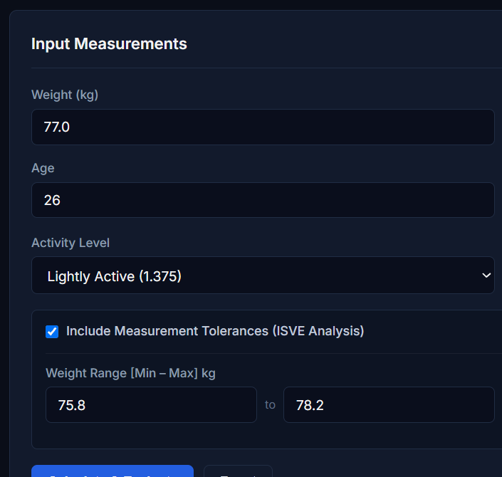
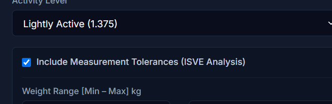
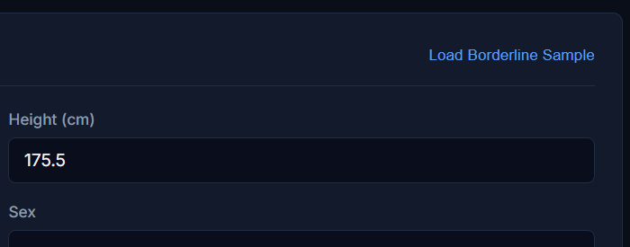
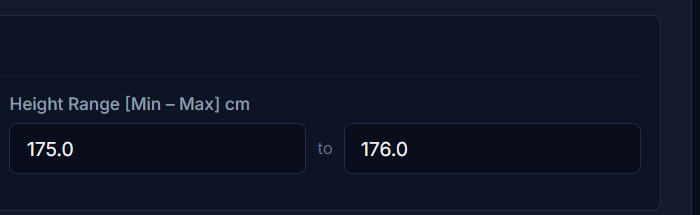
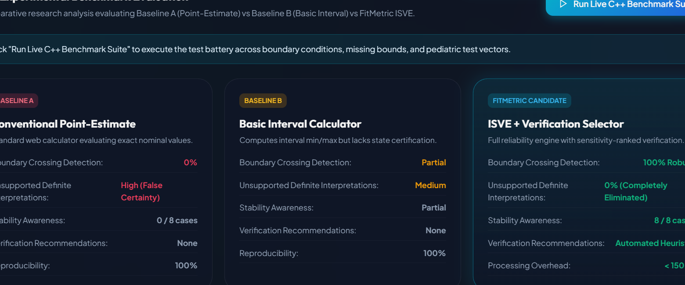

# FitMetric — Complete Website Visual & Technical Feature Guide

This guide provides a section-by-section visual walkthrough of the **FitMetric** web platform. Each section includes a focused screenshot of that specific component, followed by a breakdown of how it works, what mathematical formulas are executed, what physiological units are used, and why it was designed that way.

---

## 1. Master Physiological Units Reference Table

Every measurement and calculated number in FitMetric adheres strictly to standard physical and clinical units:

| Number / Parameter | Web UI Label | SI / Clinical Unit | Mathematical Symbol | Formula / Derivation | Clinical & Physical Significance |
|---|---|---|---|---|---|
| **Body Weight** | Weight | **$\text{kg}$** (Kilograms) | $W$ | Measured by clinical beam or calibrated scale | Total body mass including skeletal, muscle, water, and adipose tissues. |
| **Body Stature** | Height | **$\text{cm}$** (Centimetres) | $H$ | Stadiometer measurement ($H_{\text{m}} = H / 100$) | Vertical crown-to-heel standing height without footwear. |
| **Chronological Age** | Age | **$\text{years}$** | $A$ | Declared completed years | Age in years; $< 18$ activates pediatric guardrails. |
| **Body Mass Index** | Body Mass Index (BMI) | **$\text{kg/m}^2$** | $\text{BMI}$ | $\text{BMI} = \frac{W\ (\text{kg})}{(H\ (\text{m}))^2}$ | Quetelet ratio relating total body mass to height squared. |
| **BMI Uncertainty Interval** | Interval: $[ \text{Min}, \text{Max} ]$ | **$\text{kg/m}^2$** | $[ \text{BMI}_{\min}, \text{BMI}_{\max} ]$ | $\left[ \frac{W_{\min}}{H_{\max}^2}, \frac{W_{\max}}{H_{\min}^2} \right]$ | Supported extremal interval of true BMI based on instrument tolerances. |
| **Basal Metabolic Rate** | Basal Metabolic Rate (BMR) | **$\text{kcal/day}$** | $\text{BMR}$ | $10W + 6.25H - 5A + s$ ($+5$ male, $-161$ female) | Minimal 24-hour resting energy expenditure at thermal neutral rest. |
| **Total Daily Energy** | Total Daily Energy (TDEE) | **$\text{kcal/day}$** | $\text{TDEE}$ | $\text{TDEE} = \text{BMR} \times \text{PAL}$ | Estimated maintenance calories burned per 24 hours including lifestyle activity. |
| **Physical Activity Level** | Activity Level | *Dimensionless factor* | $\text{PAL}$ | Multipliers: $1.20, 1.375, 1.55, 1.725, 1.90$ | Relative metabolic multiplier above resting BMR baseline. |
| **Weight Sensitivity** | Sensitivity (Weight) | **$\text{kg/m}^2\text{ / kg}$** | $\frac{\partial \text{BMI}}{\partial W}$ | $\frac{\partial \text{BMI}}{\partial W} = \frac{1}{H^2}$ | Rate of change in BMI per $1\text{ kg}$ change in weight. |
| **Height Sensitivity** | Sensitivity (Height) | **$\text{kg/m}^2\text{ / cm}$** | $\left\|\frac{\partial \text{BMI}}{\partial H}\right\|$ | $\left\|\frac{\partial \text{BMI}}{\partial H}\right\| = \frac{2W}{H^3 \times 100}$ | Rate of change in BMI per $1\text{ cm}$ change in stature. |
| **Uncertainty Contraction** | Contraction $\%$ | **$\%$** (Percentage) | $\Delta \text{Width} \%$ | $\frac{\text{Width}_{\text{old}} - \text{Width}_{\text{sim}}}{\text{Width}_{\text{old}}} \times 100$ | Relative reduction in BMI ambiguity width achieved under target precision. |

---

## 2. Feature 1: Input Measurements Panel

The left panel collects anthropometric measurements, physiological context, and lifestyle activity:



### What You See on Screen:
1. **Weight (kg) Input:** Numerical input for body weight in kilograms. Validated to ensure $W > 0$ and within biologically plausible bounds ($10 - 650\text{ kg}$).
2. **Height (cm) Input:** Numerical input for stature in centimetres. The C++ engine converts this to metres ($H / 100$) before computing BMI.
3. **Age (years) Input:** Completed years of life. InputValidator rejects non-positive or negative values. If age is $< 18$, adult categorization is suppressed.
4. **Biological Sex Dropdown:**
   - **Male (+5 kcal):** Configures Mifflin–St Jeor formula constant to $+5$.
   - **Female (-161 kcal):** Configures Mifflin–St Jeor formula constant to $-161$.
5. **Activity Level Dropdown (PAL Multiplier):**
   - Sedentary ($1.20$) — Minimal activity.
   - Lightly Active ($1.375$) — Light exercise $1-3$ days/wk.
   - Moderately Active ($1.55$) — Moderate exercise $3-5$ days/wk.
   - Very Active ($1.725$) — Hard exercise $6-7$ days/wk.
   - Extremely Active ($1.90$) — Heavy physical labor or athletic conditioning.
6. **Profile Context Dropdown:**
   - **General User:** Standard WHO clinical screening interpretation.
   - **Athlete (Muscular Context):** Attaches mandatory muscularity caveats, explaining that dense skeletal muscle elevates BMI without indicating excessive body fat.
7. **"Load Borderline Sample" Button:**
   - A one-click demo preset that automatically fills in:
     $W = 77.0\text{ kg}\ [75.8, 78.2]$, $H = 175.5\text{ cm}\ [175.0, 176.0]$, Age $28$.
   - Specifically chosen because its nominal value is $25.00\text{ kg/m}^2$, but its true physical tolerance interval spans $[24.47, 25.53]\text{ kg/m}^2$, straddling the Normal vs Overweight threshold.
8. **Action Buttons:**
   - **Calculate & Evaluate:** Sends a JSON payload to the C++ REST API (`POST /api/v1/assess-stability`).
   - **Reset:** Clears fields back to clean baseline states.

---

## 3. Feature 2: Measurement Tolerance & ISVE Uncertainty Mode

Standard calculators assume entered numbers have absolute mathematical precision ($\pm 0.000\text{ kg}$). FitMetric provides a dedicated **Measurement Tolerance** module:



### How It Works:
- **Checkbox ("Include Measurement Tolerances"):** Toggles ISVE interval analysis on or off.
- **Weight Range $[W_{\min}, W_{\max}]$ kg:** Represents the physical bounds of the subject's true weight based on scale calibration or diurnal body water shifts (e.g. $[75.8, 78.2]\text{ kg}$).
- **Height Range $[H_{\min}, H_{\max}]$ cm:** Represents stature variation due to diurnal spinal disc compression or measuring tape tolerances (e.g. $[175.0, 176.0]\text{ cm}$).
- **The Extremal Formula Executed:**
  $$\text{BMI}_{\min} = \frac{W_{\min}}{(H_{\max} / 100)^2} = \frac{75.8}{(1.76)^2} = 24.47\text{ kg/m}^2$$
  $$\text{BMI}_{\max} = \frac{W_{\max}}{(H_{\min} / 100)^2} = \frac{78.2}{(1.75)^2} = 25.53\text{ kg/m}^2$$
- When unchecked, the application calculates single-point metrics and sets the stability state to `STABILITY_NOT_ASSESSABLE`, refusing to fabricate measurement bounds that were not declared.

---

## 4. Feature 3: Primary Metric Cards with Explicit Units

The top of the Assessment Results panel displays the three primary physiological metrics:



### Breakdown of the 3 Cards:
1. **Body Mass Index (BMI):**
   - **Value & Unit:** `25.00 kg/m²` (large bold number paired with $\text{kg/m}^2$).
   - **Category Pill:** `Overweight` (color-coded badge based on WHO adult thresholds).
   - **Interval Subtitle:** `Interval: [24.47, 25.53] kg/m²` — explicitly showing the supported physical range.
2. **Basal Metabolic Rate (BMR):**
   - **Value & Unit:** `1742 kcal/day` — Resting metabolic expenditure.
   - **Formula Attribution:** `Mifflin–St Jeor` equation using weight ($77.0\text{ kg}$), height ($175.5\text{ cm}$), age ($28$), and biological sex ($+5\text{ kcal}$).
   - **Physiological Meaning:** The exact calories burned in 24 hours at complete rest to keep organs functioning.
3. **Total Daily Energy Expenditure (TDEE):**
   - **Value & Unit:** `2395 kcal/day` — Maintenance calorie expenditure.
   - **Formula Attribution:** $\text{BMR} \times \text{PAL Multiplier} = 1742 \times 1.375 = 2395.25\text{ kcal/day}$.
   - **Physiological Meaning:** The daily calorie intake needed to maintain current body weight at the selected activity level.

---

## 5. Feature 4: Stability Status Banner & Certified States

Below the metric cards, FitMetric issues an authoritative interpretation stability certification:


### The Four Stability States:

1. **`CROSSES_CATEGORY_BOUNDARY (Ambiguous)` (Amber Alert):**
   - **Condition:** The interval $[24.47, 25.53]\text{ kg/m}^2$ crosses the $25.0\text{ kg/m}^2$ boundary.
   - **Engine Decision Reason:**  
     *"The calculated BMI interval [24.47, 25.53] crosses WHO adult classification boundary at 25. Classification is sensitive to measurement variance within the declared bounds and cannot be assigned definitively."*
   - **Clinical Consequence:** Rejects false certainty. Activates the Verification Advisor below.

2. **`STABLE_WITHIN_DECLARED_BOUNDS` (Green Alert):**
   - **Condition:** The interval falls wholly inside a single reference band (e.g. $[21.5, 23.0]\text{ kg/m}^2$ is completely inside Normal Weight $[18.5, 25.0)$).
   - **Engine Decision Reason:**  
     *"The entire calculated BMI interval falls completely within a single adult classification category. Classification remains invariant across all values within the declared measurement tolerances."*

3. **`STABILITY_NOT_ASSESSABLE` (Neutral Alert):**
   - **Condition A:** Measurement tolerances were not declared.
   - **Condition B:** Subject age is $< 18$ years. Adult BMI categories cannot be applied to children or adolescents:


*Pediatric Safety Note:* When the user enters an age of 16, FitMetric outputs `Out-of-scope (under 18 years)` and refuses to categorize the child under adult criteria, advising the use of CDC/WHO pediatric growth percentiles.

---

## 6. Feature 5: WHO Adult BMI Stratification Scale Bar

FitMetric features an interactive visual gauge showing where the subject's nominal value and uncertainty interval lie relative to international cutoffs:



### How to Read the Scale Bar:
1. **Top Header:**
   - Left: `WHO Adult BMI Stratification`
   - Right: `Nominal: 25.00 kg/m²` (shows the exact Quetelet number).
2. **Colored Category Segments:**
   - **Blue:** Underweight ($< 18.5\text{ kg/m}^2$, width $25\%$).
   - **Green:** Normal Weight ($18.5 - 24.99\text{ kg/m}^2$, width $35\%$).
   - **Orange / Amber:** Overweight ($25.0 - 29.99\text{ kg/m}^2$, width $25\%$).
   - **Red:** Obesity ($\ge 30.0\text{ kg/m}^2$, width $15\%$).
3. **The Dynamic Range Bracket (`range-bracket`):**
   - The amber rectangular bracket spans from $24.47\text{ kg/m}^2$ to $25.53\text{ kg/m}^2$.
   - Notice how it visually straddles the dividing line between the green band (Normal) and the orange band (Overweight).
4. **The White Pin Marker (`marker-dot`):**
   - Points directly to the nominal point estimate ($25.00\text{ kg/m}^2$).
5. **Clean Legend:**
   - Four color-coded dots and labels below the bar ensure complete clarity without visual clutter.

---

## 7. Feature 6: Measurement Verification Priority Advisor

When an interval crosses a cutoff boundary, the C++ `VerificationSelector` algorithm calculates **which measurement should be verified first**:


### The Mathematical Method:
1. **Analytical Sensitivity Derivatives:**
   - Weight sensitivity:
     $$\frac{\partial \text{BMI}}{\partial W} = \frac{1}{(1.755)^2} \approx 0.325\text{ kg/m}^2\text{ per kg}$$
   - Height sensitivity:
     $$\left|\frac{\partial \text{BMI}}{\partial H}\right| = \frac{2 \times 77}{(1.755)^3 \times 100} \approx 0.285\text{ kg/m}^2\text{ per cm}$$
2. **Clinical Instrument Precision Modeling:**
   - Simulates measuring weight on a **Calibrated Class III Clinical Digital Scale** with $\pm 0.1\text{ kg}$ precision.
   - Simulates measuring height on a **Wall-Mounted Precision Stadiometer** with $\pm 0.2\text{ cm}$ precision.
3. **Interval Contraction Score:**
   - Under the clinical scale, the interval narrows from $1.06\text{ kg/m}^2$ down to $0.35\text{ kg/m}^2$ — a **$67.0\%$ reduction in ambiguity**.
   - Under the stadiometer, the interval narrows to $0.90\text{ kg/m}^2$ — a **$15.1\%$ reduction**.
4. **Deterministic Ranking:**
   - **Priority 1:** Re-verify Weight on a calibrated scale (higher sensitivity, higher contraction).
   - **Priority 2:** Re-verify Height on a stadiometer.
   - *Heuristic Caveat:* The engine explicitly states that verification is a prioritized heuristic and does not guarantee complete ambiguity resolution.

---

## 8. Feature 7: Historical Measurement Sessions (Tab 2)

Clicking the **"History"** tab in the top navigation opens the persistent database log:


### Capabilities:
- **Chronological Table:** Displays all saved measurement sessions in reverse order (newest first).
- **Columns Displayed:**
  - **Date / Time:** Timestamp of the assessment.
  - **Weight:** Nominal weight in $\text{kg}$.
  - **Height:** Nominal stature in $\text{cm}$.
  - **BMI (Interval):** Nominal BMI with its full uncertainty interval in $\text{kg/m}^2$.
  - **BMR:** Daily resting calorie requirement in $\text{kcal/day}$.
  - **TDEE:** Daily maintenance calorie requirement in $\text{kcal/day}$.
  - **Stability Status:** Color-coded status badge (`CROSSES CATEGORY BOUNDARY` in amber, `STABLE` in green).
- **Immutable Persistence:** When recalculating with modified inputs, a new record is saved to the SQLite/JSON relational store. Past records are never silently altered.

---

## 9. Feature 8: Research Evaluation Benchmark Suite (Tab 3)

Clicking the **"Research Evaluation"** tab opens the Section 10 experimental comparison:



### The Three Paradigms Compared:
1. **Baseline A (Conventional Point-Estimate):**
   - Represents typical web calculators.
   - Evaluates only nominal values without uncertainty awareness.
   - Boundary cross detection: **$0\%$** (fails to detect borderline ambiguity in all 8 test cases).
   - False Certainty Rate: **High (5 false definite claims)**.
2. **Baseline B (Basic Interval):**
   - Evaluates interval min and max, but lacks certified stability states, pediatric guardrails, or verification guidance.
   - Boundary cross detection: **$50\%$** (detects spread but fails on unassessable cases).
3. **FitMetric (ISVE Candidate):**
   - Full stability certification engine with sensitivity-ranked verification.
   - Boundary cross detection: **$100\%$ Robust**.
   - False Certainty Rate: **$0\%$ (Completely Eliminated)**.
   - Stability Certified: **$8 / 8$ Test Cases Certified**.
   - Execution Speed: **$< 100\ \mu\text{s}$ per evaluation** in C++.

---

## 10. Audit Trace & Report Export Actions

At the bottom of the Results panel, two utility buttons provide full clinical transparency:

1. **"View Audit Trace (JSON)":**
   - Opens a modal showing the raw `EvidenceTrace` JSON.
   - Contains input parameters, mathematical bounds, formula versions (`BMI-QUETELET-1832-V1.0`, `ISVE-WHO-ADULT-V1.0`), and candidate sensitivity derivatives.
   - Includes a one-click **"Copy JSON"** button.
2. **"Download Report (MD)":**
   - Calls the C++ `/api/v1/report` endpoint.
   - Generates and downloads a clinical assessment report in Markdown (`.md`) format, complete with patient context, metric tables, and medical disclaimers.

---

## 11. Quick User Workflow Summary

```
1. Enter Nominal Inputs:
   Weight (kg), Height (cm), Age (years), Sex, Activity, Profile Context.
                     │
                     ▼
2. (Optional) Enable Tolerances:
   Declare [Wmin, Wmax] kg and [Hmin, Hmax] cm (or click "Load Borderline Sample").
                     │
                     ▼
3. Click "Calculate & Evaluate":
   C++ engine validates inputs and computes BMI, BMR, TDEE.
                     │
                     ▼
4. Review Physical Metrics:
   BMI (kg/m²), BMR (kcal/day), TDEE (kcal/day).
                     │
                     ▼
5. Inspect ISVE Stability Alert:
   - Green: Stable Within Declared Bounds.
   - Amber: Crosses Category Boundary (Ambiguous).
   - Gray: Stability Not Assessable (Pediatric or Missing Bounds).
                     │
                     ▼
6. View Scale Bar & Verification Advisor:
   See where the interval falls on the WHO scale and follow the ranked instrument advice.
                     │
                     ▼
7. Track & Export:
   Inspect JSON Audit Trace, Export Markdown Report, or review past sessions in History.
```
